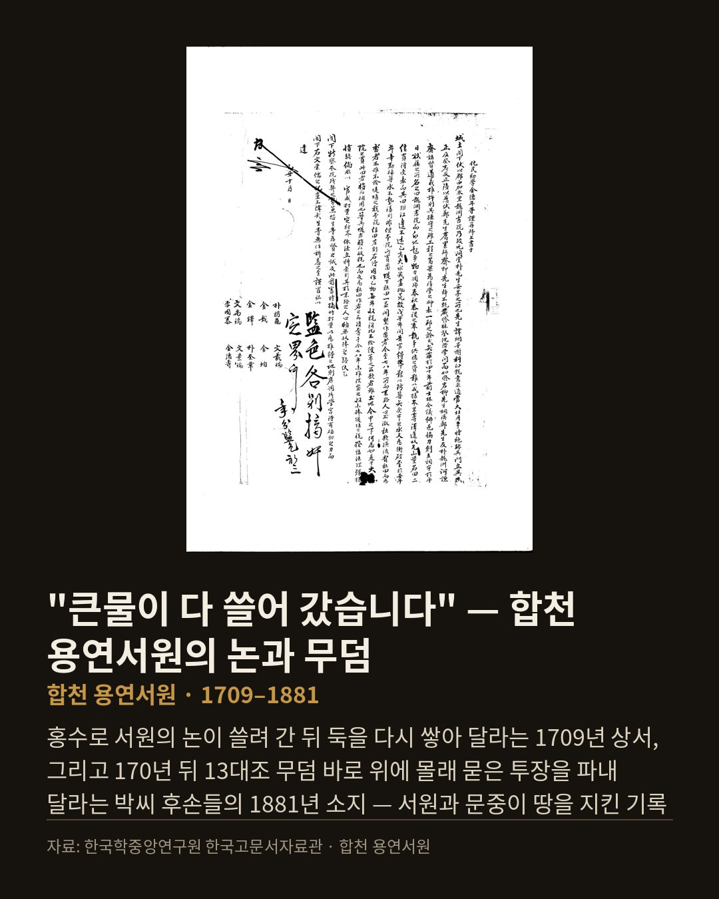
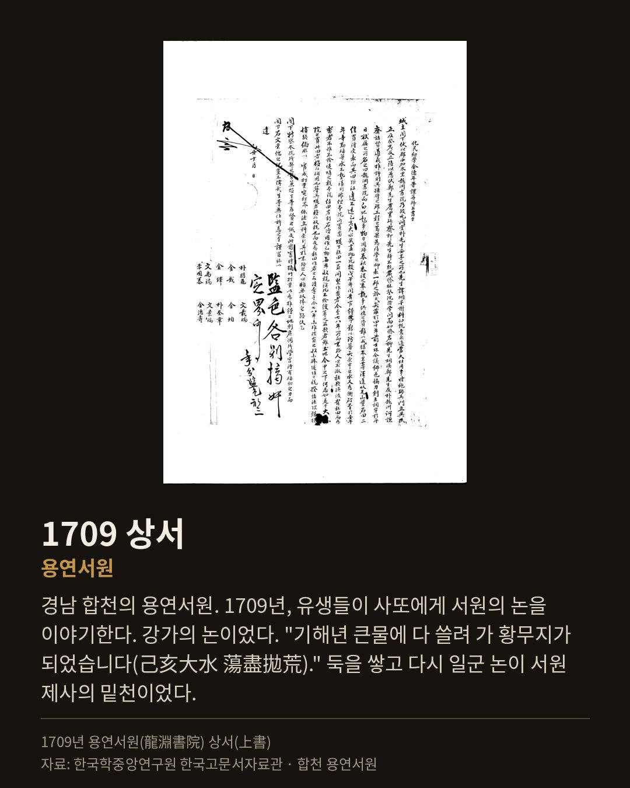
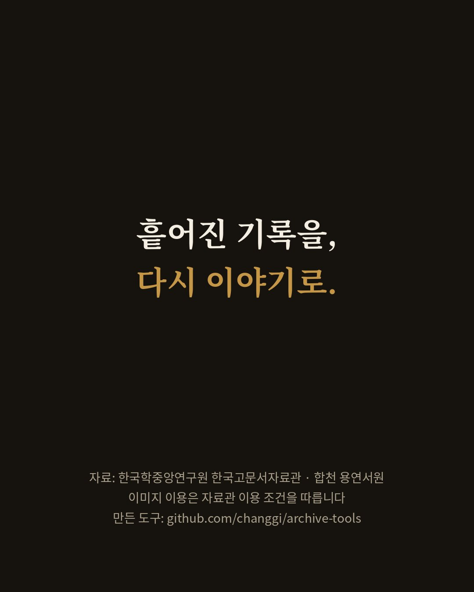

# EP.46 "큰물이 다 쓸어 갔습니다" — 합천 용연서원의 논과 무덤

합천 용연서원 (서원) · 홍수로 서원의 논이 쓸려 간 뒤 둑을 다시 쌓아 달라는 1709년 상서, 그리고 170년 뒤 13대조 무덤 바로 위에 몰래 묻은 투장을 파내 달라는 박씨 후손들의 1881년 소지 — 서원과 문중이 땅을 지킨 기록

- 🌐 [전시 웹페이지](https://changgi.github.io/archive-tools/examples/yongyeon/exhibit.html) (한자 위 한글 독음 · 원문 해석) · [수업 활동지](https://changgi.github.io/archive-tools/examples/yongyeon/handout.html)
- 🎬 영상: [릴스 9:16](https://changgi.github.io/archive-tools/examples/media/ep46-yongyeon_reel.mp4) · [가로 16:9](https://changgi.github.io/archive-tools/examples/media/ep46-yongyeon_wide.mp4) · 홍보 글: [`promo.md`](promo.md)
- 카드뉴스: [`cards/`](cards/) · SNS 글: [`sns.txt`](sns.txt) · 판독·해석 표: [`selection.csv`](selection.csv)


<!-- CURATOR -->
## 비하인드 — 큐레이터 노트

- **왜 이 문서들인가** — 큰물에 쓸려 간 서원 논의 기록과, 조상 무덤 위에 생긴 낯선 무덤을 고발한 소지가 같은 서원에 있었습니다.
- **전하고 싶은 것** — 자연재해와 사람 사이의 분쟁이 모두 서원의 생존 문제였다는 것.
- **이렇게 보이길 바랐다** — 큰물(1709) → 투장(1881), 서로 다른 위기를 한 서원의 이야기로 묶었습니다.
- **이렇게 써 주세요** — 재난과 공동체, 산송 수업에 쓰세요.
- **남겨 둔 질문** — 큰물이 쓸어 간 논을 다시 일군 사람들은 누구였을까요?
- **제작 기록** — 문서 2건 · 1709–1881년 · 원본 사진 3면(문서 전체) · 원문 판독 2건 · 번역 2건 · 못 읽은 글자 □ 0 · 불확실 (?) 6 · 해제에 "확인 필요"를 단 문서 1건

전문: [`curator.md`](curator.md)
<!-- /CURATOR -->

## 이야기 — 사료가 말하는 대로

가을 성묘를 갔더니, 조상 무덤 바로 위에 낯선 무덤이 생겨 있었습니다.

> **1709 상서** — 경남 합천의 용연서원. 1709년, 유생들이 사또에게 서원의 논을 이야기한다. 강가의 논이었다. "기해년 큰물에 다 쓸려 가 황무지가 되었습니다(己亥大水 蕩盡拋荒)." 둑을 쌓고 다시 일군 논이 서원 제사의 밑천이었다.
> **1881 소지** — 170년 뒤 1881년 가을, 같은 합천의 박씨 후손들이 13대조 무덤에 성묘하러 간다. 무덤 바로 위에 낯선 무덤이 생겨 있었다. "하늘은 아득하여 산을 가리키며 물어도, 빈 산은 고요하다(太空冥冥 指山而問焉 空山寂寂)." 땅을 지키는 일은 물과의 싸움이었고, 또 사람과의 싸움이었다.

| 표지 | 1번 카드 | 마무리 |
|---|---|---|
|  |  |  |

## 선별 문서 (2점)

| # | 연도 | 유형 | 문서명 | 원본 |
|---|---|---|---|---|
| 1 | 1709 | 상서 | 1709년 용연서원(龍淵書院) 상서(上書) | [원본 보기](https://archive.aks.ac.kr/viewer/viewer.do#imgnode.do?itemId=book&gubun=booktree&depth=6&upPath=02%5E0248%5EL024801%5EL024801F02%5EL024801F0202&dataId=G002%2BAKS%2BKSM-XB.1709.4889-20101008.B018a_029_00039_001&itemType=) |
| 2 | 1881 | 소지 | 1881년 박우신(朴雨新) 등 소지(所志) | [원본 보기](https://archive.aks.ac.kr/viewer/viewer.do#imgnode.do?itemId=book&gubun=booktree&depth=6&upPath=02%5E0248%5EL024801%5EL024801F02%5EL024801F0202&dataId=G002%2BAKS%2BKSM-XB.1881.0000-20101008.B018b_030_00005_XXX&itemType=) |

## 원문 판독과 해석

### 1. 1709년 용연서원(龍淵書院) 상서(上書)

**원문 판독**

```
化民幼學金德年等謹再拜上書于
城主閤下 伏以郡西加衣里龍淵書院 乃故冶(?)堂朴先生安享之所也 先生諱絪 早謝科臼 銳意求道 當大北用事
之日 及癸亥反正後 以遺逸 伏鄭先生薦累拜齋郞 先生辭不就 藏修林壑 沈潛學問 而如修巖柳先生 桐溪鄭
先生 諸賢 道義推許 則其操守之確 工程之篤 果爲後學之師表 一鄕之矜式矣 莖於四十年前 士林合議 卽(?)
其杖屨之所 名之曰龍淵書院 而白地起事 物力凋殘 春秋香禮之奉 執事供饋之資 難以成樣 本里等(…)
借買得處 表而其田距江邊不遠 己亥大水 蕩盡拋荒 故戊午年間 告官得發丁夫 以防築矣 庚申之
年 幸勤補等水不墊溺 則非但本院所買當堤下私田一畓 開墾作畓者 今至七八年 而來(?)路人心不淑(…)
(이하 왼쪽 — 둑 수리와 부역을 청하는 사연, 연명 김○○·문○○ 등, 관의 처분 '監色各別摘奸 定界(?)向事' — 판독 필요)
```

**원문 해석** 교화를 받는 백성 유학 김덕년 등이 삼가 두 번 절하고 사또께 글을 올립니다. 엎드려 아뢰건대, 군 서쪽 가의리의 용연서원은 돌아가신 [야?]당 박 선생을 모신 곳입니다. 선생의 이름은 인(絪)으로, 일찍 과거 공부를 그만두고 도를 구하는 데 뜻을 두어, 대북이 권력을 잡았을 때와 계해년(1623) 반정 뒤에 유일(遺逸)로 천거되어 여러 번 재랑에 임명되었으나 나아가지 않고 숲과 골짜기에 숨어 학문에 침잠하셨습니다. 수암 류 선생, 동계 정 선생 같은 여러 현인이 도의로 높였으니, 그 지조의 확고함과 공부의 독실함이 과연 후학의 스승이요 한 고을의 본보기였습니다. 40년 전 사림이 합의하여 선생이 머물던 곳에 용연서원이라 이름 붙였으나, 맨땅에서 일을 시작하여 재력이 쇠잔하니 봄가을 제사와 집사를 대접할 밑천을 마련하기 어려웠습니다. … 사들인 논이 강가에서 멀지 않아 기해년(1699) 큰물에 다 쓸려 가 황무지가 되었으므로, 무오년(1708?) 무렵 관에 고하여 장정을 내어 둑을 쌓았습니다. 경신년에 다행히 부지런히 보수하여 물에 잠기지 않게 되자, 서원이 사들인 둑 아래 논뿐 아니라 개간하여 논을 만든 지 이제 7~8년이 되었는데, 오가는 사람들의 마음이 좋지 않아 … (이하 판독 필요)

**해제** 1709년(숙종 35), 합천 유생 김덕년 등이 합천군수에게 올린 상서입니다. 용연서원에 모신 박인(朴絪, 1583~1640)의 학덕을 먼저 소개하고, 서원 재정의 바탕인 논이 1699년 홍수(己亥大水)로 쓸려 갔다가 둑을 쌓아 되살린 내력을 적은 뒤, 둑과 논에 관한 문제를 호소하는 내용입니다. 왼쪽 큰 글씨는 관의 처분으로 '監色各別摘奸(감색이 각별히 조사하라)'으로 읽힙니다. 마이크로필름 복사본이고 문서명은 1709년이나 본문 연도 계산은 확인이 필요합니다.

### 2. 1881년 박우신(朴雨新) 등 소지(所志)

**원문 판독**

```
陜川伊泗洞居朴雨新朴龍洙朴龍義
右謹言伏以 民等 貫籍高靈 而奠居于陜川伊泗洞者 屢百有年所也 十三代祖奉翊大夫判司(…)墳墓在於(…)
十里許也 未得數數省掃 而今秋時祀時 來視則 先塋本身 陟右偏十餘尺之地 忽入偷塚 此何變也 此何(…)
太空冥冥 指山而問焉 空山寂寂 一片石面 亦無堪語 於誰可問 於何可訴 顚倒跳踊 不勝憤血號訴于
墓郞下 官軍督掘 押近之偸塚 使此爲人子孫者 以保先塋之地 千萬血祝
行下向敎事
城主 處分
辛巳十一月 日 朴應麟 朴孝佑 朴龍化 朴龍彩 朴潤淳 朴達淳 … (연명 10여 명)
(왼쪽 큰 흘림 — 관의 처분: 推捉(?)…掘(?)…, 판독 필요)
```

**원문 해석** 합천 이사동에 사는 박우신·박용수·박용의. 삼가 아룁니다. 저희는 본관이 고령인데 합천 이사동에 터 잡고 산 지 수백 년이 되었습니다. 13대조 봉익대부 판사(…)의 무덤이 [마을에서] 10리쯤 되는 곳에 있어 자주 성묘하지 못하였는데, 올가을 시제 때 와서 보니 선영 바로 위 오른쪽으로 치우친 열 자 남짓한 땅에 갑자기 몰래 쓴 무덤(투장)이 들어와 있었습니다. 이 무슨 변고입니까. … 하늘은 아득하여 산을 가리키며 물어도, 빈 산은 고요하고 한 조각 비석조차 말이 없으니, 누구에게 묻고 어디에 하소연하겠습니까. 엎드러지고 발을 구르며 분한 피를 이기지 못해 호소하오니, 관의 군졸로 하여금 가까이 붙여 쓴 투장을 독촉해 파내게 하시어, 사람의 자손 된 저희가 선영의 땅을 지킬 수 있게 해 주시기를 천만 피눈물로 빕니다. 사또께서 처분하실 일. 신사년(1881) 11월 일. 박응린·박효우·박용화 … 등.

**해제** 1881년(고종 18, 辛巳) 11월, 합천 이사동의 고령박씨 박우신 등이 합천군수에게 올린 산송(山訟) 소지입니다. 13대조 무덤 바로 위 열 자 남짓한 곳에 누군가 몰래 묘를 쓴(偸塚) 것을 가을 시제 때 발견하고, 관이 파내 달라고 청했습니다. '하늘은 아득하고 빈 산은 고요하며 비석은 말이 없다'는 문장으로 억울함을 표현했습니다. 이듬해 같은 사람들의 소지가 또 있어 다툼이 이어진 것으로 보입니다. 해서로 또렷해 본문 대부분을 판독했습니다.

판독·해석·이야기는 이미지에 근거한 초안이며(검토 전 "초안" 표시), 정확한 판독은 원문 확인이 필요합니다. □는 읽지 못한 글자, (?)는 불확실한 글자입니다.
이미지: 한국학중앙연구원 한국고문서자료관 소장·제공. "원본" 링크를 누르면 자료관 뷰어에서 그 문서가 열립니다. 재사용은 자료관에 문의하세요(소장처 동의 필요).
