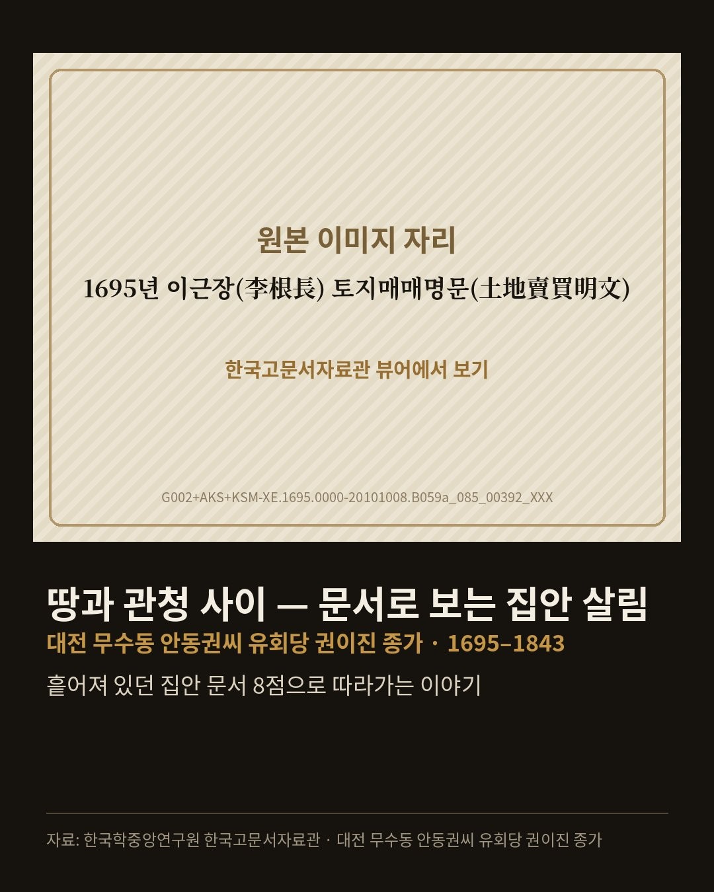
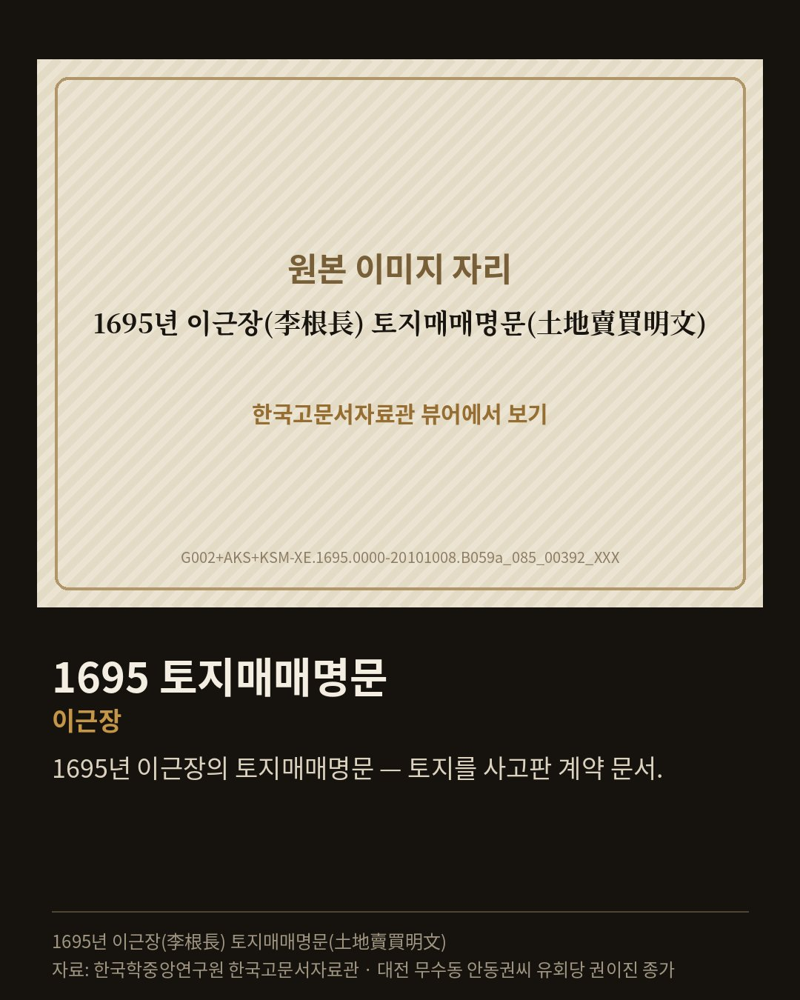
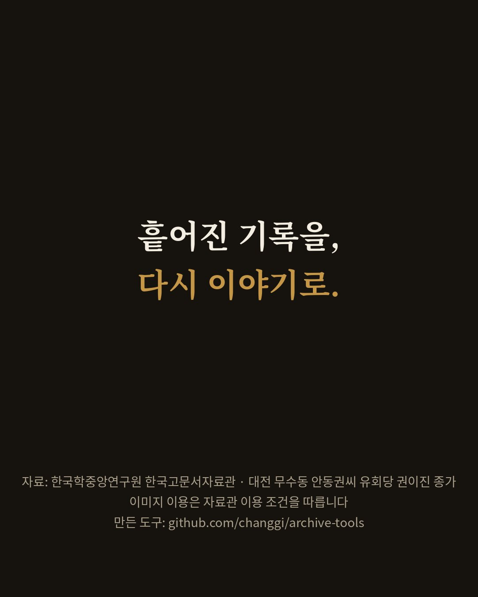

# 땅과 관청 사이 — 문서로 보는 집안 살림

대전 무수동 안동권씨 유회당 권이진 종가 · 문서유형으로 직접 정한 테마 (`edit --types`)

- 🌐 [전시 웹페이지](https://changgi.github.io/archive-tools/examples/yuhoedang-land/exhibit.html) · [수업 활동지](https://changgi.github.io/archive-tools/examples/yuhoedang-land/handout.html)
- 카드뉴스: [`cards/`](cards/) · SNS 글: [`sns.txt`](sns.txt) · 에디팅 결과: [`selection.csv`](selection.csv)

| 표지 | 1번 카드 | 마무리 |
|---|---|---|
|  |  |  |

## 선별 문서

| # | 연도 | 유형 | 문서명 | 원본 |
|---|---|---|---|---|
| 1 | 1695 | 토지매매명문 | 1695년 이근장(李根長) 토지매매명문(土地賣買明文) | [원본 보기](https://archive.aks.ac.kr/viewer/viewer.do#imgnode.do?itemId=book&gubun=booktree&depth=6&upPath=01%5E0130%5EL013003%5EL013003F02%5EL013003F0205&dataId=G002%2BAKS%2BKSM-XE.1695.0000-20101008.B059a_085_00392_XXX&itemType=) |
| 2 | 1712 | 토지매매명문 | 1712년 승(僧) 수담(守淡) 토지매매명문(土地賣買明文) | [원본 보기](https://archive.aks.ac.kr/viewer/viewer.do#imgnode.do?itemId=book&gubun=booktree&depth=6&upPath=01%5E0130%5EL013003%5EL013003F02%5EL013003F0205&dataId=G002%2BAKS%2BKSM-XE.1712.0000-20101008.B059a_085_00385_XXX&itemType=) |
| 3 | 1783 | 첩정 | 1783년 용안현감(龍安縣監) 첩정(牒呈)－1 | [원본 보기](https://archive.aks.ac.kr/viewer/viewer.do#imgnode.do?itemId=book&gubun=booktree&depth=6&upPath=01%5E0130%5EL013003%5EL013003F02%5EL013003F0203&dataId=G002%2BAKS%2BKSM-XC.1783.0000-20101008.B059a_085_00315_001&itemType=) |
| 4 | 1793 | 고목 | 1793년 김인택(金仁澤) 고목(告目)－1 | [원본 보기](https://archive.aks.ac.kr/viewer/viewer.do#imgnode.do?itemId=book&gubun=booktree&depth=6&upPath=01%5E0130%5EL013003%5EL013003F02%5EL013003F0203&dataId=G002%2BAKS%2BKSM-XC.1793.0000-20101008.B059a_085_00321_XXX&itemType=) |
| 5 | 1793 | 고목 | 1793년 김인협(金仁協) 고목(告目)－3 | [원본 보기](https://archive.aks.ac.kr/viewer/viewer.do#imgnode.do?itemId=book&gubun=booktree&depth=6&upPath=01%5E0130%5EL013003%5EL013003F02%5EL013003F0203&dataId=G002%2BAKS%2BKSM-XC.1793.0000-20101008.B059a_085_00328_XXX&itemType=) |
| 6 | 1793 | 고목 | 1793년 유명덕(柳命德) 고목(告目)－2 | [원본 보기](https://archive.aks.ac.kr/viewer/viewer.do#imgnode.do?itemId=book&gubun=booktree&depth=6&upPath=01%5E0130%5EL013003%5EL013003F02%5EL013003F0203&dataId=G002%2BAKS%2BKSM-XC.1793.0000-20101008.B059a_085_00337_XXX&itemType=) |
| 7 | 1843 | 노비매매명문 | 1843년 남유희(南有羲) 노비매매명문(奴婢賣買明文) | [원본 보기](https://archive.aks.ac.kr/viewer/viewer.do#imgnode.do?itemId=book&gubun=booktree&depth=6&upPath=01%5E0130%5EL013003%5EL013003F02%5EL013003F0205&dataId=G002%2BAKS%2BKSM-XE.1843.0000-20101008.B059a_085_00386_XXX&itemType=) |
| 8 | — | 고목 | 이봉휘(李鳳輝) 고목(告目) | [원본 보기](https://archive.aks.ac.kr/viewer/viewer.do#imgnode.do?itemId=book&gubun=booktree&depth=6&upPath=01%5E0130%5EL013003%5EL013003F02%5EL013003F0203&dataId=G002%2BAKS%2BKSM-XC.0000.0000-20101008.B059a_085_00345_XXX&itemType=) |

원본 이미지는 소장처 동의가 필요해 자리 표시로 대신했습니다. 링크를 누르면 한국고문서자료관 뷰어에서 문서가 열립니다.
