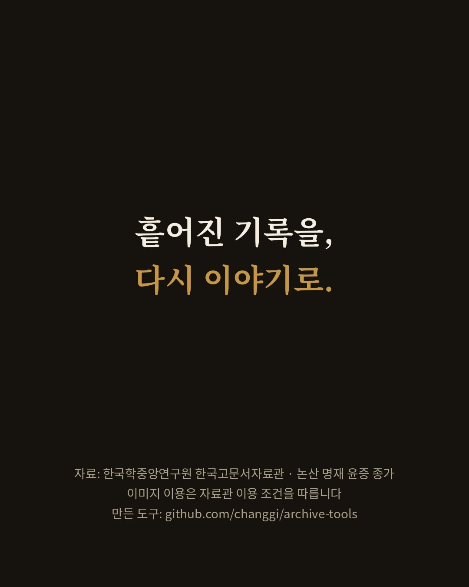

# EP.14 나아가지 않은 선비

논산 명재 윤증 종가 (문중) · 임명장 36장, 부름 18번 — 쌓인 문서가 말하는 명재 윤증의 선택

- 🌐 [전시 웹페이지](https://changgi.github.io/archive-tools/examples/yunjeung/exhibit.html) · [수업 활동지](https://changgi.github.io/archive-tools/examples/yunjeung/handout.html)
- 🎬 영상: [릴스 9:16](https://changgi.github.io/archive-tools/examples/media/ep14-yunjeung_reel.mp4) · [가로 16:9](https://changgi.github.io/archive-tools/examples/media/ep14-yunjeung_wide.mp4) · 홍보 글: [`promo.md`](promo.md)
- 카드뉴스: [`cards/`](cards/) · SNS 글: [`sns.txt`](sns.txt) · 에디팅 결과: [`selection.csv`](selection.csv)

## 이야기 (영상 내레이션)

> 임금이 수십 번 불러도, 나아가지 않은 선비가 있습니다.
> 1665년, 임명장인 고신이 내려지고,
> 1668년, 임금은 "역마를 타고 속히 올라오라"는 유지를 보냅니다.
> 1681년에도 같은 부름.
> 1682년 한 해에만 고신이 일곱 장.
> 1701년엔 숭정대부 의정부 좌찬성까지.
> 그는 끝내 조정에 나아가지 않은 것으로 알려져 있습니다. 쌓인 임명장이 그 선택을 말해 줍니다.

| 표지 | 1번 카드 | 마무리 |
|---|---|---|
|  |  |  |

## 선별 문서 (8점)

| # | 연도 | 유형 | 문서명 | 원본 |
|---|---|---|---|---|
| 1 | 1654 | 화회문기 | 1654년 윤증(尹拯) 화회문기(和會文記) | [원본 보기](https://archive.aks.ac.kr/viewer/viewer.do#imgnode.do?itemId=book&gubun=booktree&depth=6&upPath=01%5E0144%5EL014418%5EL014418F02%5EL014418F0205&dataId=G002%2BAKS%2BKSM-XE.1654.0000-20101008.B004a_004_00349_XXX&itemType=) |
| 2 | 1665 | 고신 | 1665년 윤증(尹拯) 고신(告身) | [원본 보기](https://archive.aks.ac.kr/viewer/viewer.do#imgnode.do?itemId=book&gubun=booktree&depth=6&upPath=01%5E0144%5EL014418%5EL014418F02%5EL014418F0201&dataId=G002%2BAKS%2BKSM-XA.1665.1111-20101008.B004a_004_00173_XXX&itemType=) |
| 3 | 1666 | 간찰 | 1666년 윤증(尹拯) 간찰(簡札)－1 | [원본 보기](https://archive.aks.ac.kr/viewer/viewer.do#imgnode.do?itemId=book&gubun=booktree&depth=6&upPath=01%5E0144%5EL014418%5EL014418F02%5EL014418F0206&dataId=G002%2BAKS%2BKSM-XF.0000.0000-20101008.B004a_004_00919_XXX&itemType=) |
| 4 | 1668 | 유지 | 1668년 윤증(尹拯) 유지(有旨)－1 | [원본 보기](https://archive.aks.ac.kr/viewer/viewer.do#imgnode.do?itemId=book&gubun=booktree&depth=6&upPath=01%5E0144%5EL014418%5EL014418F02%5EL014418F0201&dataId=G002%2BAKS%2BKSM-XA.1668.1111-20101008.B004a_004_00221_XXX&itemType=) |
| 5 | 1681 | 유지 | 1681년 윤증(尹拯) 유지(有旨)－1 | [원본 보기](https://archive.aks.ac.kr/viewer/viewer.do#imgnode.do?itemId=book&gubun=booktree&depth=6&upPath=01%5E0144%5EL014418%5EL014418F02%5EL014418F0201&dataId=G002%2BAKS%2BKSM-XA.1681.1111-20101008.B004a_004_00237_XXX&itemType=) |
| 6 | 1682 | 고신 | 1682년 윤증(尹拯) 고신(告身)－1 | [원본 보기](https://archive.aks.ac.kr/viewer/viewer.do#imgnode.do?itemId=book&gubun=booktree&depth=6&upPath=01%5E0144%5EL014418%5EL014418F02%5EL014418F0201&dataId=G002%2BAKS%2BKSM-XA.1682.1111-20101008.B004a_004_00054_XXX&itemType=) |
| 7 | 1701 | 간찰 | 1701년 윤증(尹拯) 간찰(簡札) | [원본 보기](https://archive.aks.ac.kr/viewer/viewer.do#imgnode.do?itemId=book&gubun=booktree&depth=6&upPath=01%5E0144%5EL014418%5EL014418F02%5EL014418F0206&dataId=G002%2BAKS%2BKSM-XF.0000.0000-20101008.B004a_004_01316_XXX&itemType=) |
| 8 | 1701 | 고신 | 1701년 윤증(尹拯) 고신(告身) | [원본 보기](https://archive.aks.ac.kr/viewer/viewer.do#imgnode.do?itemId=book&gubun=booktree&depth=6&upPath=01%5E0144%5EL014418%5EL014418F02%5EL014418F0201&dataId=G002%2BAKS%2BKSM-XA.1701.1111-20101008.B004a_004_00077_XXX&itemType=) |

이야기는 문서명과 이미지에서 보이는 것에 근거한 초안이며(검토 전 "초안" 표시), 판독·해석은 원문 확인이 필요합니다.
이미지: 한국학중앙연구원 한국고문서자료관 소장·제공. "원본" 링크를 누르면 자료관 뷰어에서 그 문서가 열립니다. 재사용은 자료관에 문의하세요(소장처 동의 필요).
