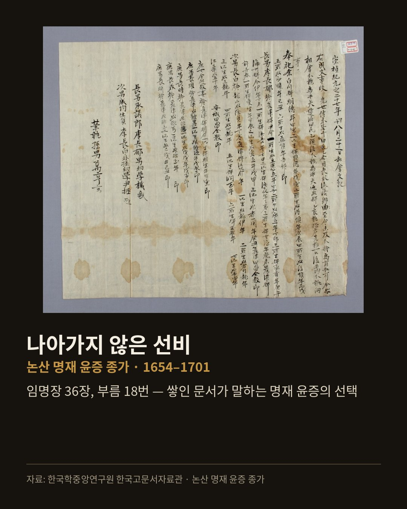
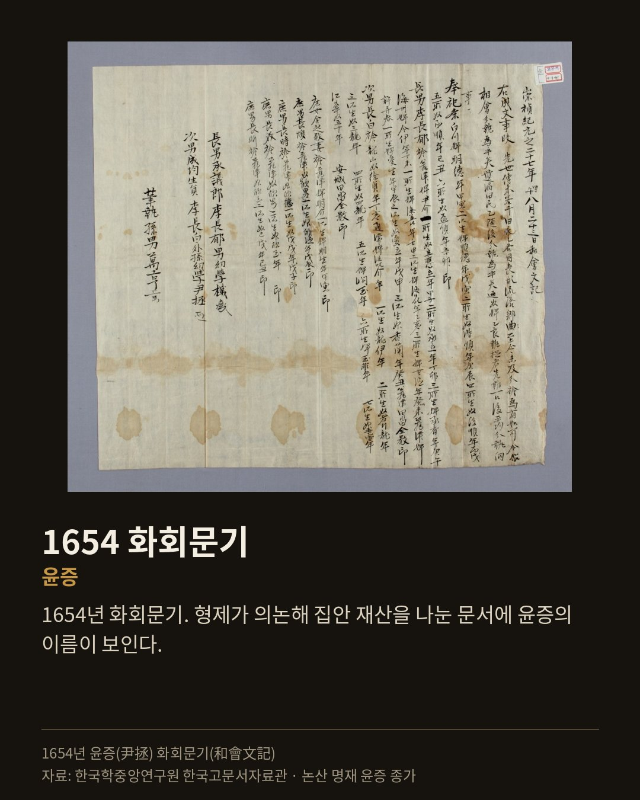

# EP.14 나아가지 않은 선비

논산 명재 윤증 종가 (문중) · 임명장 36장, 부름 18번 — 쌓인 문서가 말하는 명재 윤증의 선택

- 🌐 [전시 웹페이지](https://changgi.github.io/archive-tools/examples/yunjeung/exhibit.html) · [수업 활동지](https://changgi.github.io/archive-tools/examples/yunjeung/handout.html)
- 🎬 영상: [릴스 9:16](https://changgi.github.io/archive-tools-next/media/ep14-yunjeung_reel.mp4) · [가로 16:9](https://changgi.github.io/archive-tools-next/media/ep14-yunjeung_wide.mp4) · 홍보 글: [`promo.md`](promo.md)
- 카드뉴스: [`cards/`](cards/) · SNS 글: [`sns.txt`](sns.txt) · 에디팅 결과: [`selection.csv`](selection.csv)

## 이야기 (영상 내레이션)

> 임금이 수십 번 불러도, 나아가지 않은 선비가 있습니다.
> 1665년, 임명장인 고신이 내려지고,
> 1668년, 임금은 "역마를 타고 속히 올라오라"는 유지를 보냅니다.
> 1681년에도 같은 부름.
> 1682년 한 해에만 고신이 일곱 장.
> 1701년엔 숭정대부 의정부 좌찬성까지.
> 그는 끝내 조정에 나아가지 않은 것으로 알려져 있습니다. 쌓인 임명장이 그 선택을 말해 줍니다.

| 표지 | 1번 카드 | 마무리 |
|---|---|---|
|  |  |  |

<!-- DELIVERY -->
## 전달 에디팅 — 이 기록을 이렇게 전합니다

- **핵심 정서** — 신념
- **한 문장** — 나아가지 않는 것도 하나의 선택이자 신념이었다는 것.
- **열기** — 임금이 거듭 불러도 나아가지 않은 선비가 있습니다.
- **펼치기** — 윤증 화회문기 → 윤증 고신 → 윤증 간찰－1 → 윤증 유지－1 → 윤증 고신－1 → 윤증 간찰 (1654–1701년) — 반복되는 부름의 문서를 쌓아 보여 주어, 그 거절의 무게가 느껴지게 했습니다.
- **절정** — 1668년 "역마를 타고 속히 올라오라"는 유지 — 그리고 나아가지 않은 선비 — 이 장면에서 멈추고 크게
- **여운** — 그토록 부름을 거절한 이유를 그는 어디에 남겼을까요? — 질문으로 끝내고 답은 보는 사람에게
- **감각과 물질** — 임명장 36장을 바닥에 흩고, 그 위를 걸어 나가는 동선 — 거절의 무게 · 어보·관인 탁본 스탬프를 찍어 보는 체험 · 손바닥 크기 복제를 직접 들고 읽기, 낭독 음성 · 역마 방울·말발굽 소리와 함께 펼치는 두루마리
- **통로와 매개** — 온라인: 릴스(열기) → 카드뉴스(펼치기) → 전시 웹페이지(절정·원문) → 비하인드 카드(여운) / 오프라인: 원본 크기 복제·낭독·참여 벽 / 남기기: 활동지·질문 카드
- **여운 장치** — "나는 무엇을 거절할 수 있나" 질문
- **전달 에디팅 전** — 8건의 문서를 1654–1701년 연대순으로 놓고 문서명 · 유형 · 해설을 붙인다 — 정확하지만, 지나가면 잊힌다.
- **전달 에디팅 후** — 핵심 정서는 「신념」. 「임금이 거듭 불러도 나아가지 않은 선비가 있습니다.」로 열고, 문서를 대비와 순서로 펼친 뒤, 1668년 "역마를 타고 속히 올라오라"는 유지에서 멈춘다. 임명장 36장을 바닥에 흩고, 그 위를 걸어 나가는 동선 — 거절의 무게. 마지막엔 「"나는 무엇을 거절할 수 있나" 질문」로 보는 사람이 자기 이야기를 남기고 떠나게 한다.

전문: [`delivery.md`](delivery.md)
<!-- /DELIVERY -->

<!-- CURATOR -->
## 비하인드 — 큐레이터 노트

- **왜 이 문서들인가** — 임명장 36점과 유지 18점 — 임금이 거듭 불러도 나아가지 않은 선비의 기록이 압도적인 양으로 남아 있었습니다.
- **전하고 싶은 것** — 나아가지 않는 것도 하나의 선택이자 신념이었다는 것.
- **이렇게 보이길 바랐다** — 반복되는 부름의 문서를 쌓아 보여 주어, 그 거절의 무게가 느껴지게 했습니다.
- **이렇게 써 주세요** — 조선의 산림(山林), 출처(出處) 의식을 다루는 수업에 쓰세요.
- **만들며 있었던 일** — 처음에는 문서명으로 캡션 초안만 만들었고, 뒤에 원문 전문 판독(v0.3.6)과 원문 해석(v0.4.0)을 더해 지금 모습이 되었습니다.
- **남겨 둔 질문** — 그토록 부름을 거절한 이유를 그는 어디에 남겼을까요?
- **제작 기록** — 문서 8건 · 1654–1701년 · 원본 사진 11면(문서 전체) · 원문 판독 7건 · 번역 8건

전문: [`curator.md`](curator.md)
<!-- /CURATOR -->

## 선별 문서 (8점)

| # | 연도 | 유형 | 문서명 | 원본 |
|---|---|---|---|---|
| 1 | 1654 | 화회문기 | 1654년 윤증(尹拯) 화회문기(和會文記) | [원본 보기](https://archive.aks.ac.kr/viewer/viewer.do#imgnode.do?itemId=book&gubun=booktree&depth=6&upPath=01%5E0144%5EL014418%5EL014418F02%5EL014418F0205&dataId=G002%2BAKS%2BKSM-XE.1654.0000-20101008.B004a_004_00349_XXX&itemType=) |
| 2 | 1665 | 고신 | 1665년 윤증(尹拯) 고신(告身) | [원본 보기](https://archive.aks.ac.kr/viewer/viewer.do#imgnode.do?itemId=book&gubun=booktree&depth=6&upPath=01%5E0144%5EL014418%5EL014418F02%5EL014418F0201&dataId=G002%2BAKS%2BKSM-XA.1665.1111-20101008.B004a_004_00173_XXX&itemType=) |
| 3 | 1666 | 간찰 | 1666년 윤증(尹拯) 간찰(簡札)－1 | [원본 보기](https://archive.aks.ac.kr/viewer/viewer.do#imgnode.do?itemId=book&gubun=booktree&depth=6&upPath=01%5E0144%5EL014418%5EL014418F02%5EL014418F0206&dataId=G002%2BAKS%2BKSM-XF.0000.0000-20101008.B004a_004_00919_XXX&itemType=) |
| 4 | 1668 | 유지 | 1668년 윤증(尹拯) 유지(有旨)－1 | [원본 보기](https://archive.aks.ac.kr/viewer/viewer.do#imgnode.do?itemId=book&gubun=booktree&depth=6&upPath=01%5E0144%5EL014418%5EL014418F02%5EL014418F0201&dataId=G002%2BAKS%2BKSM-XA.1668.1111-20101008.B004a_004_00221_XXX&itemType=) |
| 5 | 1681 | 유지 | 1681년 윤증(尹拯) 유지(有旨)－1 | [원본 보기](https://archive.aks.ac.kr/viewer/viewer.do#imgnode.do?itemId=book&gubun=booktree&depth=6&upPath=01%5E0144%5EL014418%5EL014418F02%5EL014418F0201&dataId=G002%2BAKS%2BKSM-XA.1681.1111-20101008.B004a_004_00237_XXX&itemType=) |
| 6 | 1682 | 고신 | 1682년 윤증(尹拯) 고신(告身)－1 | [원본 보기](https://archive.aks.ac.kr/viewer/viewer.do#imgnode.do?itemId=book&gubun=booktree&depth=6&upPath=01%5E0144%5EL014418%5EL014418F02%5EL014418F0201&dataId=G002%2BAKS%2BKSM-XA.1682.1111-20101008.B004a_004_00054_XXX&itemType=) |
| 7 | 1701 | 간찰 | 1701년 윤증(尹拯) 간찰(簡札) | [원본 보기](https://archive.aks.ac.kr/viewer/viewer.do#imgnode.do?itemId=book&gubun=booktree&depth=6&upPath=01%5E0144%5EL014418%5EL014418F02%5EL014418F0206&dataId=G002%2BAKS%2BKSM-XF.0000.0000-20101008.B004a_004_01316_XXX&itemType=) |
| 8 | 1701 | 고신 | 1701년 윤증(尹拯) 고신(告身) | [원본 보기](https://archive.aks.ac.kr/viewer/viewer.do#imgnode.do?itemId=book&gubun=booktree&depth=6&upPath=01%5E0144%5EL014418%5EL014418F02%5EL014418F0201&dataId=G002%2BAKS%2BKSM-XA.1701.1111-20101008.B004a_004_00077_XXX&itemType=) |

이야기는 문서명과 이미지에서 보이는 것에 근거한 초안이며(검토 전 "초안" 표시), 판독·해석은 원문 확인이 필요합니다.
이미지: 한국학중앙연구원 한국고문서자료관 소장·제공. "원본" 링크를 누르면 자료관 뷰어에서 그 문서가 열립니다. 재사용은 자료관에 문의하세요(소장처 동의 필요).
